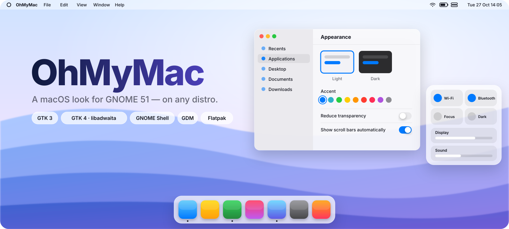
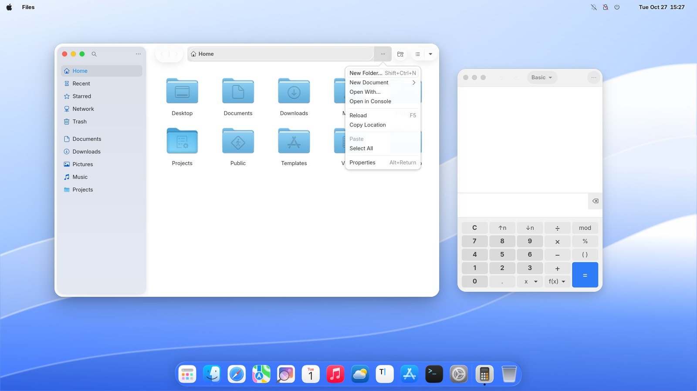
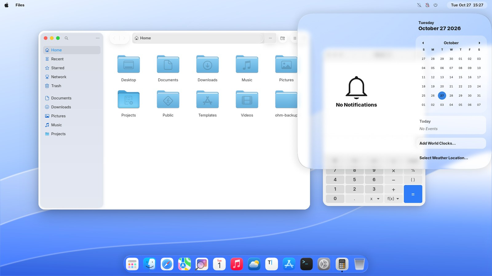
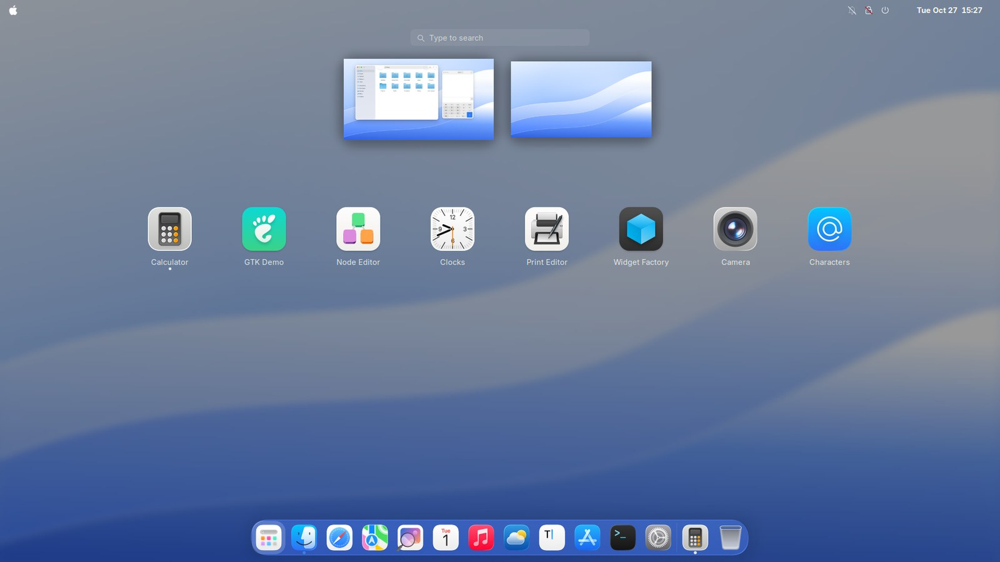
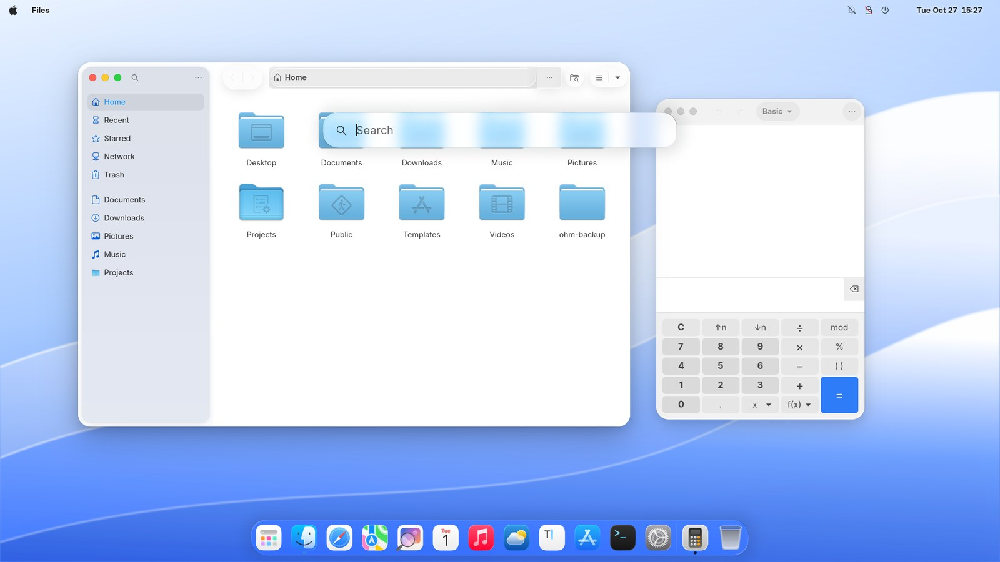
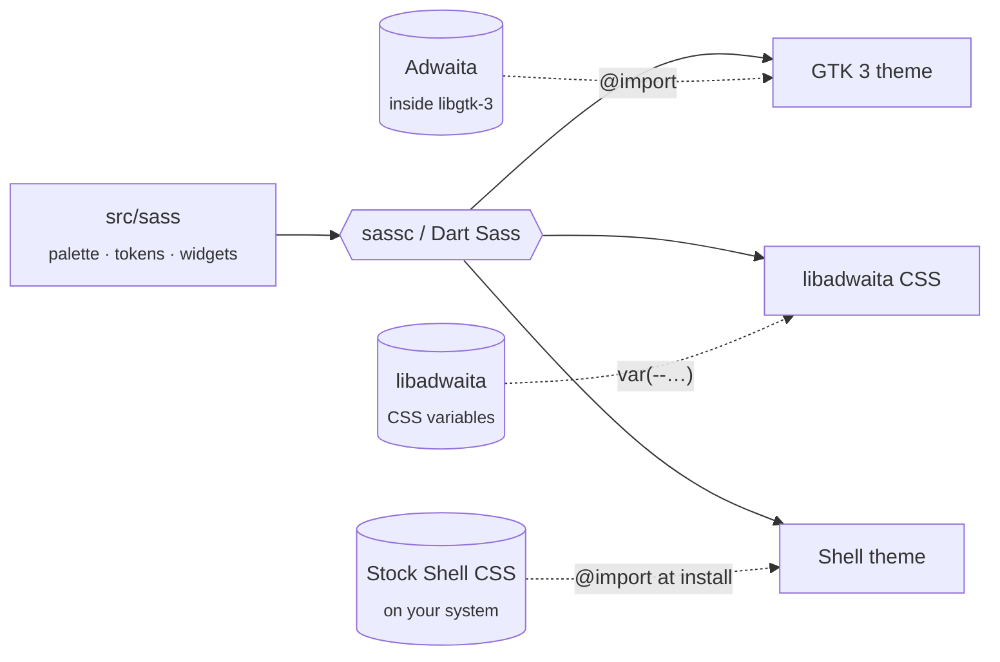

<p align="center">
  <picture>
    <source media="(prefers-color-scheme: dark)" srcset="docs/assets/banner-dark.svg">
    
  </picture>
</p>

<h3 align="center">Your GNOME desktop, dressed as macOS Tahoe.</h3>

<p align="center">
  GTK 3 &nbsp;·&nbsp; GTK 4 / libadwaita &nbsp;·&nbsp; GNOME Shell &nbsp;·&nbsp; Login screen &nbsp;·&nbsp; Flatpak<br>
  <sub>One command. Nine distro families. Fully reversible.</sub>
</p>

<p align="center">
  <a href="https://github.com/cmpdchtr/OhMyMac/actions/workflows/ci.yml"></a>
  
  
  <a href="LICENSE"></a>
</p>

<p align="center">
  <a href="#-quick-start"><b>Quick start</b></a> &nbsp;•&nbsp;
  <a href="#-features"><b>Features</b></a> &nbsp;•&nbsp;
  <a href="#-supported-distributions"><b>Distros</b></a> &nbsp;•&nbsp;
  <a href="#%EF%B8%8F-options"><b>Options</b></a> &nbsp;•&nbsp;
  <a href="#-how-it-works"><b>How it works</b></a> &nbsp;•&nbsp;
  <a href="#-faq"><b>FAQ</b></a>
</p>

<br>

## ⚡ Quick start

```bash
git clone https://github.com/cmpdchtr/OhMyMac.git && cd OhMyMac && ./install.sh
```

Then **log out and back in**. That's it.

> [!TIP]
> Not sure yet? `./install.sh --dry-run` prints every step without touching your system,
> and `./uninstall.sh` puts everything back exactly how it was.

<br>

## 📸 Screenshots

<sub>Real screenshots of GNOME Shell 51.0 on Fedora 45 with the default install (MacTahoe base + OhMyMac layer) — no mock-ups.</sub>

<p align="center">
  <picture>
    <source media="(prefers-color-scheme: dark)" srcset="docs/screenshots/desktop-dark.jpg">
    
  </picture>
</p>

<table>
<tr>
<td width="50%"></td>
<td width="50%"></td>
</tr>
<tr>
<td align="center"><sub><b>Notification Center</b> — real refraction, not a flat blur</sub></td>
<td align="center"><sub><b>Launchpad</b> — app grid over the blurred wallpaper</sub></td>
</tr>
<tr>
<td colspan="2"></td>
</tr>
<tr>
<td colspan="2" align="center"><sub><b>Spotlight</b> on <kbd>Super</kbd>+<kbd>Space</kbd> — apps, settings, files and maths, on glass</sub></td>
</tr>
</table>

<br>

## ✨ Features

<table>
<tr>
<td colspan="2" valign="top">

### 🎨 The best macOS theme, finished
The default **hybrid** install builds on [MacTahoe](https://github.com/vinceliuice/MacTahoe-gtk-theme)
by vinceliuice — the most faithful macOS rendition for GNOME — and adds what
it lacks: one libadwaita stylesheet that **follows light/dark automatically**,
the floating Tahoe sidebar, macOS shadows and the rest of OhMyMac.

</td>
</tr>
<tr>
<td width="50%" valign="top">

### 🚦 Windows that feel like Tahoe
Traffic lights with glyphs on hover, a unified toolbar of **glass capsule**
buttons, a **floating sidebar**, 20&nbsp;px concentric corners, capsule switches
and slider knobs — in **every** GTK&nbsp;3 and GTK&nbsp;4 app.

</td>
<td width="50%" valign="top">

### 💧 Real Liquid Glass
The Dock, menus, Control Center, Notification Center and OSDs are rendered by
[Liquid Glass](https://github.com/ryohsuke1231/liquid-glass) shaders — blur,
refraction and edge lighting — over a fully transparent, Tahoe-style menu bar.

</td>
</tr>
<tr>
<td valign="top">

### 🌗 Light & dark, automatically
One libadwaita stylesheet for both schemes. `ohmymac-sync` flips GTK&nbsp;3, the
Shell theme and icons together with the system switch — no manual theme hopping.

</td>
<td valign="top">

### 🍎 A real Mac menu bar
The bundled **OhMyMac** extension puts the focused app's name in bold next to
the logo (with New Window, Hide and Quit), moves the clock to the right edge,
slides notifications in at the top right and drops the workspace pill.
<kbd>Super</kbd>+<kbd>Space</kbd> opens Spotlight; layouts move to <kbd>Ctrl</kbd>+<kbd>Space</kbd>.

</td>
</tr>
<tr>
<td valign="top">

### 🧩 Extensions that actually load
Dock, glass, tray icons, logo menu and the genie effect are fetched for **your
exact GNOME version** (extensions.gnome.org, or a pinned upstream commit).
Anything incompatible is skipped instead of breaking your session.

</td>
<td valign="top">

### 🛡️ Survives GNOME updates
OhMyMac never ships a frozen copy of GNOME's CSS. It layers on top of the stock
stylesheet that is *on your system*, so upgrades keep working.

</td>
</tr>
<tr>
<td valign="top">

### ↩️ Fully reversible
Every file goes into a manifest and every setting is backed up before it
changes. `./uninstall.sh` restores your previous desktop — fonts, dock, all of it.

</td>
<td valign="top">

### 🐧 Any distribution
apt, dnf, pacman, zypper, xbps, apk, emerge and eopkg — plus Silverblue-style
immutable systems and NixOS. Tested on real GNOME 51 (Fedora 45) before every
release.

</td>
</tr>
</table>

<p align="center">
  <picture>
    <source media="(prefers-color-scheme: dark)" srcset="docs/assets/palette-dark.svg">
    
  </picture>
</p>

<br>

## 🐧 Supported distributions

<p align="center">
  
  
  
  
  
  
  
  
  
  
  
  
  
  
  
  
</p>

| Family | Package manager | Notes |
| :-- | :-- | :-- |
| Debian · Ubuntu · Mint · Pop!\_OS · Zorin · elementary | `apt` | Ubuntu Dock is swapped for Dash to Dock automatically |
| Fedora · Nobara · RHEL-likes | `dnf` | |
| Arch · EndeavourOS · Manjaro · CachyOS · Garuda | `pacman` | Uses Dart Sass from `extra` |
| openSUSE Tumbleweed · Leap · Slowroll | `zypper` | |
| Void · Alpine / postmarketOS · Gentoo · Solus | `xbps` · `apk` · `emerge` · `eopkg` | |
| Silverblue · Bluefin · Aurora · Aeon · Vanilla OS | — | Immutable: everything installs into `$HOME` |
| NixOS | — | Prints what to add to `configuration.nix` |

**GNOME 51** is the target; **47–51** are supported. GNOME 50+ is Wayland-only, and so is OhMyMac.

<br>

## 🚀 Installation

The installer detects your distribution, GNOME version and session, then asks
what you want. Root is only requested for dependency packages and the optional
login screen, via `sudo`, `doas` or `run0`.

> [!IMPORTANT]
> Run `./install.sh` as **your user**, not with `sudo`. On Wayland the Shell can't
> restart, so **log out and back in** afterwards to load the new extensions.

```bash
./install.sh                              # interactive, recommended set
./install.sh --all -y                     # everything, no questions (incl. login screen)
./install.sh --themes-only                # just the themes
./install.sh --variant dark --accent purple
sudo ./install.sh --system --themes-only  # themes for every user on the machine
```

### ⚙️ Options

<details>
<summary><b>Show all installer options</b></summary>
<br>

| Option | What it does |
| :-- | :-- |
| `--all` | Everything, including the full extension set and the login screen |
| `--themes-only` | GTK 3 / GTK 4 / libadwaita / Shell themes only |
| `--no-icons` `--no-cursors` `--no-fonts` `--no-wallpaper` | Skip a component |
| `--extensions minimal\|recommended\|full` | Pick an extension profile |
| `--no-extensions` | No extensions (User Themes is still added for the Shell theme) |
| `--no-settings` | Leave every GNOME setting alone |
| `--no-flatpak` | Skip Flatpak integration |
| `--gdm` | Style the login screen too (needs root) |
| `--theme hybrid\|ohmymac` | `hybrid` (default): MacTahoe base + OhMyMac layer; `ohmymac`: OhMyMac's own theme only |
| `--variant auto\|light\|dark` | Colour scheme — `auto` follows the system |
| `--accent blue\|teal\|green\|yellow\|orange\|red\|pink\|purple\|slate` | Accent colour |
| `--system` | Install themes and icons for all users |
| `--dest DIR` | Stage files under `DIR` for packaging |
| `--no-deps` | Never call the package manager |
| `--allow-incompatible` | Allow extensions not marked for your GNOME version |
| `--update-extensions` | Re-download extensions that are already installed |
| `-y` · `-n` · `-v` | Assume yes · dry run · verbose |

</details>

<details>
<summary><b>Extension profiles</b></summary>
<br>

| Profile | Adds |
| :-- | :-- |
| `minimal` | User Themes |
| `recommended` *(default)* | Dash to Dock · **Liquid Glass** · Blur my Shell (Launchpad only) · AppIndicator · Logo Menu · Magic Lamp |
| `full` | Kiwi · Just Perfection · Rounded Window Corners · Top Bar Organizer |

Profiles are plain lists in [`data/extensions/`](data/extensions) — edit them to taste.
Liquid Glass isn't on extensions.gnome.org yet, so it is fetched from its GitHub
repository at a **pinned, reviewed commit** (MIT licence).

</details>

<details>
<summary><b>Everything OhMyMac writes</b></summary>
<br>

All paths are recorded in `~/.local/state/ohmymac/manifest`.

| Path | Contents |
| :-- | :-- |
| `~/.local/share/themes/OhMyMac-{Light,Dark}` | GTK 3, GTK 4 and Shell themes |
| `~/.themes/OhMyMac-*` | Symlinks so Flatpak apps find the themes |
| `~/.config/gtk-4.0/gtk.css` | libadwaita styling — your previous file is backed up |
| `~/.local/share/gnome-shell/extensions/…` | Extensions from extensions.gnome.org |
| `~/.local/share/icons/{MacTahoe*,macOS*}` | Icons and cursors from upstream |
| `~/.local/share/fonts/Inter` | Inter, if your distro has no package |
| `~/.local/share/backgrounds/ohmymac` | Original light/dark wallpaper pair |
| `~/.local/bin/ohmymac-sync` + autostart entry | Light/dark sync |

GNOME settings live in [`data/settings/`](data/settings) as readable
`schema key value` lines. Each key's old value is saved to
`~/.local/state/ohmymac/gsettings.backup` before the first change.

</details>

### 🧹 Uninstall

```bash
./uninstall.sh                  # remove everything, restore your settings and files
./uninstall.sh --gdm            # …and the stock login screen
./uninstall.sh --keep-settings  # remove files, keep current settings
```

<br>

## 🔬 How it works

Most macOS themes ship a full, frozen copy of GNOME's stylesheets — and break
on the next GNOME release. OhMyMac **layers** instead:



- **GTK 3** imports the Adwaita stylesheet compiled into libgtk-3 and restyles only what makes it look like a Mac.
- **GTK 4 / libadwaita** is themed through libadwaita's public CSS variables, with `prefers-color-scheme` for dark mode.
- **GNOME Shell** gets an `@import` of the stock stylesheet *found on your machine* at install time — `gnome-shell-{light,dark}.css` on GNOME 47–51, `gnome-shell.css` before.
- **Glass** comes from Liquid Glass shaders in the compositor; OhMyMac's Shell theme keeps those surfaces transparent and supplies geometry and typography.

<details>
<summary><b>Repository layout</b></summary>
<br>

```
src/sass/            SCSS: palette, tokens, GTK 3, GTK 4, Shell
src/wallpapers/      original light/dark wallpaper pair
lib/                 installer modules
  distro.sh            distro, GNOME version, immutable-system detection
  packages.sh          dependency → package names for 8 package managers
  build.sh             Sass build + Shell base detection
  themes.sh            themes, libadwaita, Flatpak, fonts, icons, cursors
  extensions.sh        extensions.gnome.org, version matching, conflicts
  settings.sh          GSettings presets with backup/restore
  gdm.sh               login screen GResource rebuild
data/                extension profiles, settings presets
bin/ohmymac-sync     light/dark sync helper
packaging/           PKGBUILD (Arch) · RPM spec (Fedora)
tests/               unit tests, build checks, install round-trip
```

</details>

<br>

## 🛠️ Development

```bash
make build   # compile CSS into build/
make test    # shellcheck + Sass + unit tests + isolated install/uninstall round-trip
make dist    # release tarball with prebuilt CSS (installs without Sass)
```

Every push runs shellcheck, builds with **sassc** and **Dart Sass**, parses the
output with real **GTK 3** and **GTK 4**, and runs the installer on **Ubuntu,
Debian, Fedora, Arch, openSUSE, Alpine and Void**. Packaging recipes for Arch and
Fedora live in [`packaging/`](packaging). Contributions welcome — see
[CONTRIBUTING.md](CONTRIBUTING.md).

<br>

## 💬 FAQ

<details>
<summary><b>Where are SF Pro and the Apple wallpapers?</b></summary>
<br>
Apple's licences forbid redistributing them, so OhMyMac uses <a href="https://rsms.me/inter/">Inter</a>
and ships its own wallpapers. If you own SF Pro, drop it into <code>~/.local/share/fonts</code>
and re-run the installer — it will be picked automatically.
</details>

<details>
<summary><b>The Shell theme didn't change.</b></summary>
<br>
Log out and back in — on Wayland new extensions (including User Themes) only load at login.
Then check that <i>User Themes</i> is enabled in the Extensions app.
</details>

<details>
<summary><b>A GNOME update reset my login screen.</b></summary>
<br>
Distribution updates replace the login screen bundle. Run <code>./install.sh --gdm --themes-only</code> again.
</details>

<details>
<summary><b>Can I use it on KDE, XFCE or Cinnamon?</b></summary>
<br>
The GTK 3 and GTK 4 themes work anywhere (<code>--themes-only</code>). The Shell theme, extensions and
settings are GNOME-only.
</details>

<details>
<summary><b>Is this affiliated with Apple?</b></summary>
<br>
No. macOS is a trademark of Apple Inc. OhMyMac is an independent project.
</details>

<br>

## 💜 Credits

Inspired by **[w1nyear/macW1Y](https://github.com/w1nyear/macW1Y-GTK-Theme)**.
Built on the shoulders of
[MacTahoe GTK theme](https://github.com/vinceliuice/MacTahoe-gtk-theme) and
[Liquid Glass](https://github.com/ryohsuke1231/liquid-glass) by Ryosuke Watanabe,
[MacTahoe icons](https://github.com/vinceliuice/MacTahoe-icon-theme) by vinceliuice,
[apple_cursor](https://github.com/ful1e5/apple_cursor) by ful1e5,
[Inter](https://github.com/rsms/inter) by Rasmus Andersson,
and the authors of Dash to Dock, Blur my Shell, Kiwi and every other extension used here.

<p align="center">
  <sub>Released under <a href="LICENSE">GPL-3.0-or-later</a> · Artwork under CC BY-SA 4.0</sub><br>
  <sub>Made for people who love GNOME <i>and</i> miss their Mac.</sub>
</p>
