<h1 align="center">
  OhMyMac
</h1>

<p align="center">
  <b>Turn GNOME 51 into macOS Tahoe — Liquid Glass and all.</b><br>
  <sub>One command · any distribution · fully reversible</sub>
</p>

<p align="center">
  <a href="https://github.com/cmpdchtr/OhMyMac/actions/workflows/ci.yml"></a>
  
  
  <a href="LICENSE"></a>
</p>

<p align="center">
  <picture>
    <source media="(prefers-color-scheme: dark)" srcset="docs/media/hero-dark.webp">
    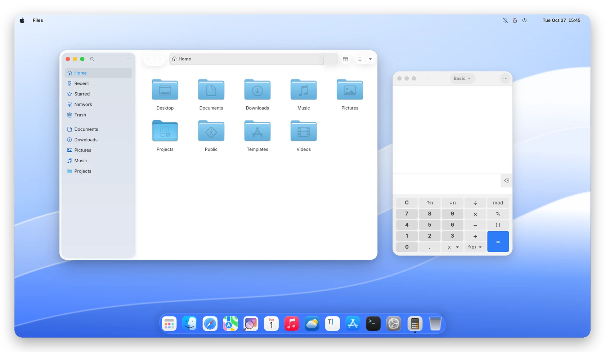
  </picture>
</p>

<p align="center">
  <sub>A real, unedited screenshot of GNOME Shell 51.0 on Fedora 45 — every image on this page is.</sub>
</p>

```bash
git clone https://github.com/cmpdchtr/OhMyMac.git && cd OhMyMac && ./install.sh
```

<p align="center">
  <a href="#-before--after"><b>Before / after</b></a> &nbsp;·&nbsp;
  <a href="#-the-tour"><b>Tour</b></a> &nbsp;·&nbsp;
  <a href="#-whats-inside"><b>What's inside</b></a> &nbsp;·&nbsp;
  <a href="#-install"><b>Install</b></a> &nbsp;·&nbsp;
  <a href="#-supported-systems"><b>Distros</b></a> &nbsp;·&nbsp;
  <a href="#-faq"><b>FAQ</b></a>
</p>

<br>

## 🔁 Before / after

Same machine, same windows, same GNOME 51. One `./install.sh` apart.

<table>
<tr>
<td width="50%" align="center"><b>Stock GNOME 51</b></td>
<td width="50%" align="center"><b>With OhMyMac</b></td>
</tr>
<tr>
<td>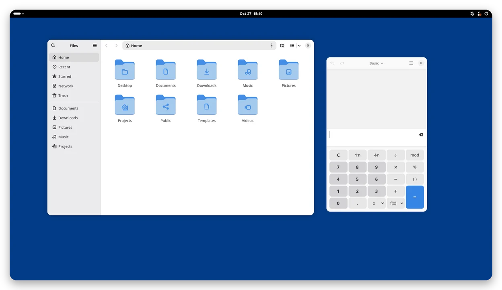</td>
<td>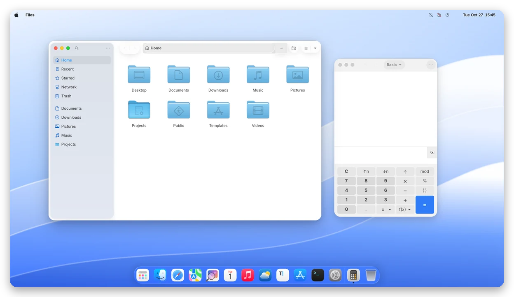</td>
</tr>
</table>

<br>

## 🧭 The tour

<table>
<tr>
<td width="50%" valign="top">
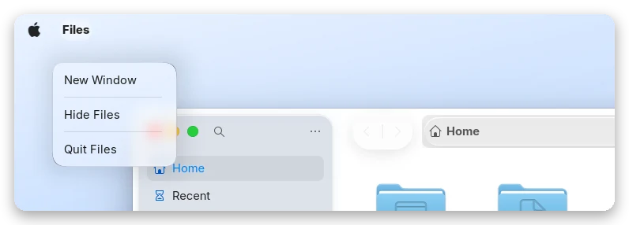
<h3>A real Mac menu bar</h3>
Logo on the left, the focused app's name in bold with <i>New Window · Hide · Quit</i>,
status icons and the clock on the right. Transparent, with dark text in light mode.
</td>
<td width="50%" valign="top">
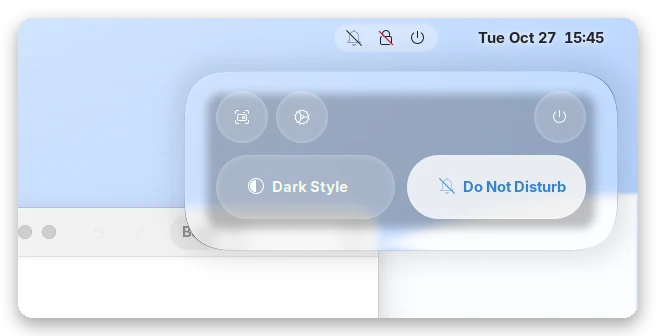
<h3>Control Center</h3>
Quick Settings rebuilt as macOS tiles on real <b>Liquid Glass</b> — refraction,
edge light and blur from GPU shaders, not a flat translucent box.
</td>
</tr>
<tr>
<td valign="top">
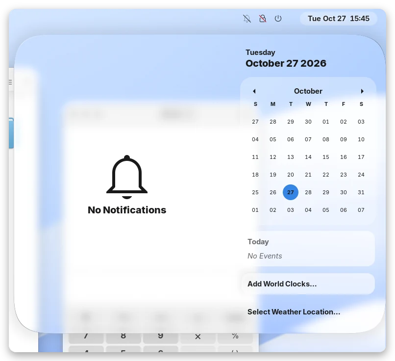
<h3>Notification Center</h3>
Calendar and notifications on one sheet of glass. Banners slide in at the
<b>top right</b>, exactly where your eyes expect them.
</td>
<td valign="top">
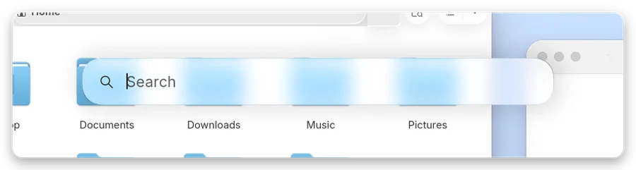
<h3>Spotlight on <kbd>Super</kbd>+<kbd>Space</kbd></h3>
Apps, settings, files and quick maths from one glass field. Keyboard layouts
move to <kbd>Ctrl</kbd>+<kbd>Space</kbd> — just like on a Mac.
<br><br>

</td>
</tr>
<tr>
<td valign="top">

<h3>The Dock, in macOS order</h3>
Launchpad, Finder, Safari, Maps, Photos, Calendar, Music, Weather, Notes,
App Store, Terminal, System Settings — filled from the apps <i>you</i> have,
on any distro. Genie minimise included.
</td>
<td valign="top">
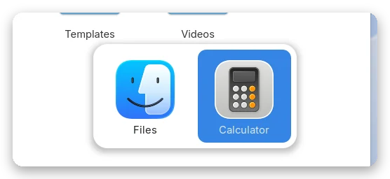
<h3>App switcher</h3>
<kbd>Super</kbd>+<kbd>Tab</kbd> brings up the familiar glass switcher with
big MacTahoe icons.
</td>
</tr>
<tr>
<td valign="top">
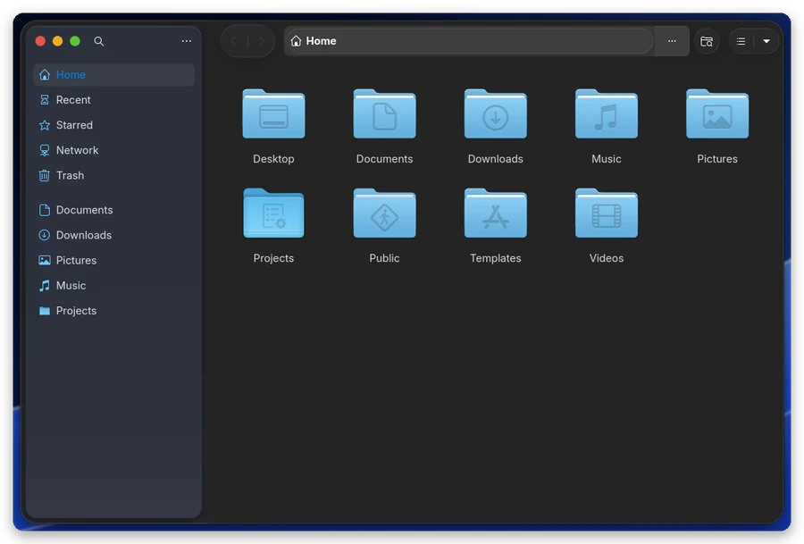
<h3>Finder-style windows</h3>
Traffic lights, a floating Tahoe sidebar with accent-tinted symbols,
glass toolbar capsules and big, soft macOS shadows.
</td>
<td valign="top">
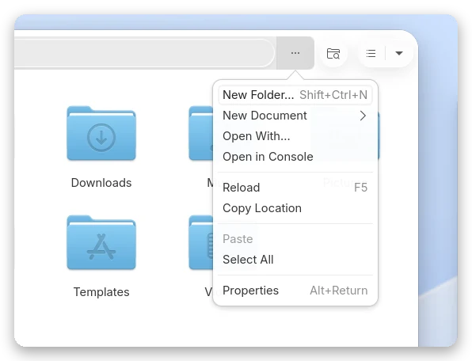
<h3>Menus that feel native</h3>
Rounded popovers, blue highlight, shortcuts on the right — in every GTK 4 and
libadwaita app.
</td>
</tr>
<tr>
<td valign="top">
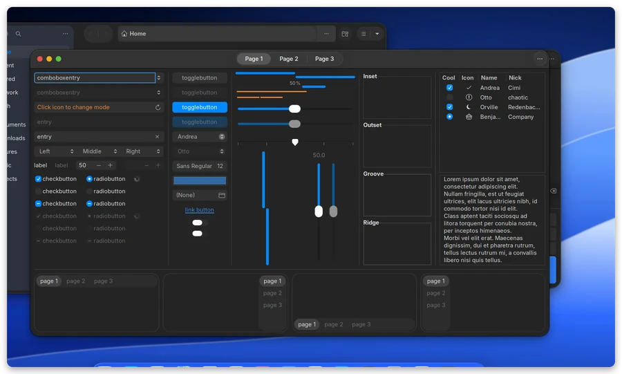
<h3>Older apps too</h3>
GTK 3 apps get macOS pop-up buttons (<code>⌃⌄</code>), capsule switches and
sliders, segmented tabs and the same traffic lights.
</td>
<td valign="top">
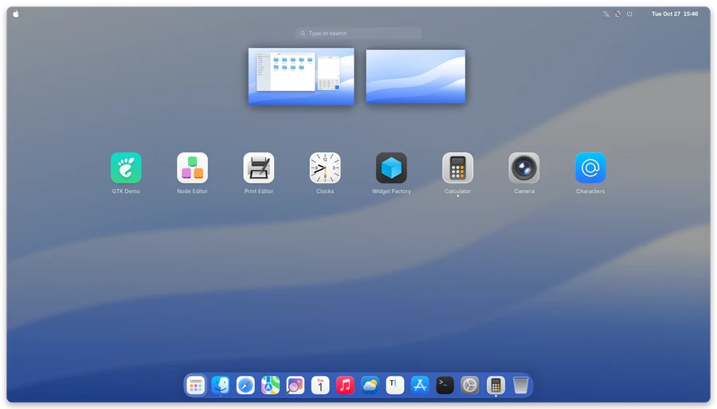
<h3>Launchpad</h3>
The app grid floats over your blurred wallpaper, opened from the Dock or the
Launchpad icon.
</td>
</tr>
</table>

<br>

### 🌗 Light and dark, automatically

Flip the switch in Quick Settings and **everything** follows — libadwaita apps,
GTK 3 apps, the Shell, the icons and the menu bar text. No log-out, no theme
hopping.

<p align="center">
  <picture>
    <source media="(prefers-color-scheme: dark)" srcset="docs/assets/palette-dark.svg">
    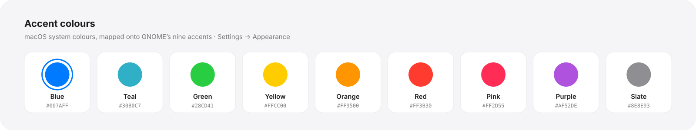
  </picture>
</p>

<br>

## 🧩 What's inside

OhMyMac doesn't reinvent what others already do brilliantly. It picks the best
pieces, pins them, fixes the gaps between them and installs the lot in one go.

| Layer | What | Source |
| :-- | :-- | :-- |
| **Base theme** | GTK 3, GTK 4 / libadwaita and Shell styling | [MacTahoe](https://github.com/vinceliuice/MacTahoe-gtk-theme) by vinceliuice — release archive at a pinned commit, SHA-256 verified |
| **Tahoe layer** | Floating sidebar, accent sidebar symbols, macOS shadows, one stylesheet for light *and* dark | OhMyMac ([`src/sass`](src/sass), [`lib/cssmerge.awk`](lib/cssmerge.awk)) |
| **Glass** | Dock, menus, Control Center, Notification Center, OSDs, Spotlight | [Liquid Glass](https://github.com/ryohsuke1231/liquid-glass) — pinned commit |
| **Menu bar** | App name & menu, clock on the right, banners top-right | OhMyMac extension ([`extensions/`](extensions)) |
| **Dock** | macOS order, Launchpad, genie effect | Dash to Dock · Magic Lamp — extensions.gnome.org |
| **Icons & cursors** | MacTahoe icons, macOS cursors | [vinceliuice](https://github.com/vinceliuice/MacTahoe-icon-theme) · [ful1e5](https://github.com/ful1e5/apple_cursor) |
| **Look & feel** | Inter (or your SF Pro), wallpapers, gestures, shortcuts | OhMyMac ([`data/settings`](data/settings)) |

Prefer a fully self-contained theme? `./install.sh --theme ohmymac` uses
OhMyMac's own GTK/Shell theme instead of MacTahoe.

<br>

## 🚀 Install

```bash
git clone https://github.com/cmpdchtr/OhMyMac.git
cd OhMyMac
./install.sh
```

The installer shows what it found (distribution, GNOME version, session) and
asks what you want. It needs root only for packages and the optional login
screen, and asks for it itself via `sudo`, `doas` or `run0`.

> [!IMPORTANT]
> Run it as **your user**, not with `sudo`, and **log out and back in** when it
> finishes — on Wayland, GNOME loads new extensions at login.

> [!TIP]
> `./install.sh --dry-run` shows every step without changing anything.

```bash
./install.sh --all -y                       # everything, incl. the login screen
./install.sh --variant dark --accent purple # pick the look up front
./install.sh --themes-only                  # just the themes, nothing else
sudo ./install.sh --system --themes-only    # themes for every user
```

<details>
<summary><b>All options</b></summary>
<br>

| Option | What it does |
| :-- | :-- |
| `--all` | Everything, including the full extension set and the login screen |
| `--themes-only` | GTK 3 / GTK 4 / libadwaita / Shell themes only |
| `--theme hybrid\|ohmymac` | `hybrid` *(default)*: MacTahoe base + OhMyMac layer · `ohmymac`: OhMyMac's own theme |
| `--variant auto\|light\|dark` | Colour scheme — `auto` follows the system |
| `--accent blue\|teal\|green\|yellow\|orange\|red\|pink\|purple\|slate` | Accent colour |
| `--extensions minimal\|recommended\|full` | Extension profile |
| `--no-icons` `--no-cursors` `--no-fonts` `--no-wallpaper` | Skip a component |
| `--no-extensions` | No extensions (User Themes is still added for the Shell theme) |
| `--no-settings` | Leave every GNOME setting alone |
| `--no-flatpak` | Skip Flatpak integration |
| `--gdm` | Style the login screen too (needs root) |
| `--system` | Install themes and icons for all users |
| `--dest DIR` | Stage files under `DIR` for packaging |
| `--no-deps` | Never call the package manager |
| `--allow-incompatible` | Allow extensions not marked for your GNOME version |
| `--update-extensions` | Re-download extensions that are already installed |
| `-y` · `-n` · `-v` | Assume yes · dry run · verbose |

</details>

<details>
<summary><b>Extension profiles</b></summary>
<br>

| Profile | Extensions |
| :-- | :-- |
| `minimal` | User Themes |
| `recommended` *(default)* | + OhMyMac · Dash to Dock · Liquid Glass · Blur my Shell (Launchpad only) · AppIndicator · Logo Menu · Magic Lamp |
| `full` | + Kiwi · Just Perfection · Rounded Window Corners · Top Bar Organizer |

Each extension is installed for **your exact GNOME version**; anything that
isn't compatible yet is skipped instead of breaking your session. Lists live in
[`data/extensions/`](data/extensions).

</details>

<details>
<summary><b>Everything OhMyMac writes</b></summary>
<br>

Every path goes into `~/.local/state/ohmymac/manifest`, and every GNOME setting
is saved to `~/.local/state/ohmymac/gsettings.backup` before it is first changed.

| Path | Contents |
| :-- | :-- |
| `~/.local/share/themes/{MacTahoe,OhMyMac}-{Light,Dark}` | GTK 3, GTK 4 and Shell themes |
| `~/.themes/…` | Symlinks so Flatpak apps find the themes |
| `~/.config/gtk-4.0/gtk.css` | libadwaita styling (your previous file is backed up) |
| `~/.local/share/gnome-shell/extensions/…` | Extensions |
| `~/.local/share/icons/{MacTahoe*,macOS*}` | Icons and cursors |
| `~/.local/share/fonts/Inter` | Inter, if your distro has no package |
| `~/.local/share/backgrounds/ohmymac` | Wallpapers |
| `~/.local/bin/ohmymac-sync` + autostart entry | Light/dark switching for GTK 3 and the Shell |

</details>

### 🧹 Uninstall

```bash
./uninstall.sh                  # remove everything and restore your previous desktop
./uninstall.sh --gdm            # …and the stock login screen
./uninstall.sh --keep-settings  # remove files, keep the current settings
```

Verified on GNOME 51: after `uninstall.sh` the desktop is back to stock, and the
login screen bundle is restored byte for byte.

<br>

## 🐧 Supported systems

<p align="center">
  
  
  
  
  
  
  
  
  
  
  
  
  
  
  
</p>

| Family | Package manager | Notes |
| :-- | :-- | :-- |
| Debian · Ubuntu · Mint · Pop!\_OS · Zorin · elementary | `apt` | Ubuntu Dock is swapped for Dash to Dock automatically |
| Fedora · Nobara · RHEL-likes | `dnf` | Reference platform — every screenshot here is Fedora 45 |
| Arch · EndeavourOS · Manjaro · CachyOS · Garuda | `pacman` | |
| openSUSE Tumbleweed · Leap · Slowroll | `zypper` | |
| Void · Alpine / postmarketOS · Gentoo · Solus | `xbps` · `apk` · `emerge` · `eopkg` | |
| Silverblue · Bluefin · Aurora · Aeon · Vanilla OS | — | Immutable: everything installs into `$HOME` |
| NixOS | — | Prints what to add to `configuration.nix` |

**GNOME 51** is the target, **47–51** are supported, Wayland only (as GNOME 50+ itself).

<br>

## 🔬 How it works

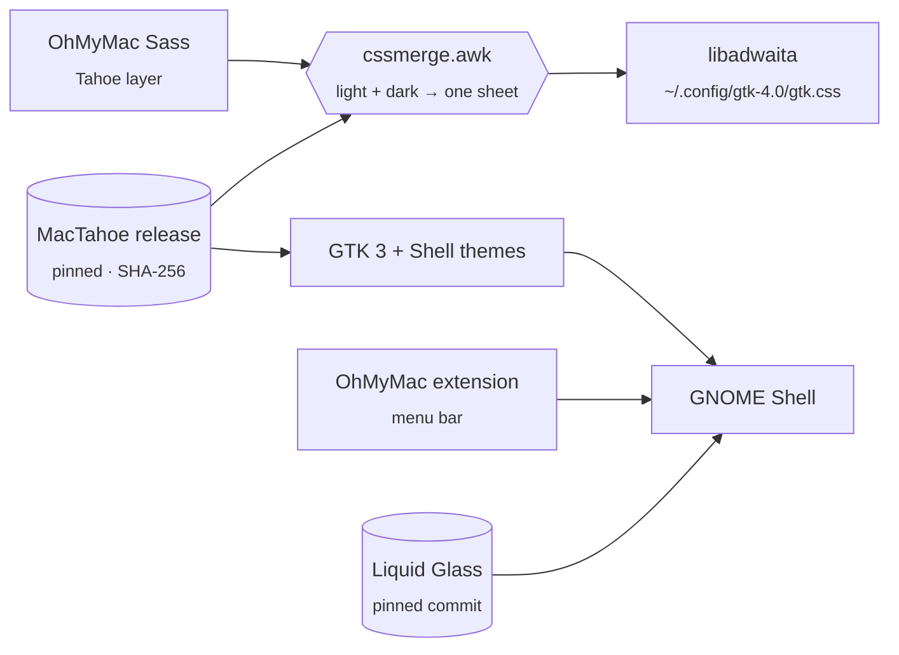

- **No upstream script ever runs.** MacTahoe comes from its prebuilt release
  archives, checked against SHA-256; Liquid Glass and the icon theme are fetched
  at pinned commits.
- **One stylesheet, both modes.** libadwaita ignores `gtk-dark.css`, so the
  installer folds MacTahoe's dark sheet into `@media (prefers-color-scheme: dark)`
  with [`lib/cssmerge.awk`](lib/cssmerge.awk) — apps switch live with the system.
- **Settings are data.** Everything OhMyMac changes is a readable line in
  [`data/settings/`](data/settings), skipped automatically when a key doesn't
  exist on your GNOME.

<details>
<summary><b>Repository layout</b></summary>
<br>

```
install.sh · uninstall.sh   entry points
lib/                        installer modules
  distro.sh                   distro, GNOME version, immutable systems
  packages.sh                 dependencies for 8 package managers
  mactahoe.sh                 MacTahoe base: download, verify, merge
  cssmerge.awk                fold a dark sheet into prefers-color-scheme
  themes.sh                   themes, libadwaita, Flatpak, fonts, icons, cursors
  extensions.sh               extensions.gnome.org, pinned git and bundled sources
  settings.sh                 GSettings with backup/restore, the Dock
  gdm.sh                      login screen bundle
extensions/                 the OhMyMac Shell extension (menu bar)
src/sass/                   OhMyMac's own theme and the Tahoe layer
data/                       extension profiles, settings presets
bin/ohmymac-sync            light/dark switching for GTK 3 and the Shell
packaging/                  PKGBUILD (Arch) · RPM spec (Fedora)
tests/                      unit tests, Sass build, install round-trip
```

</details>

<br>

## 🛠️ Development

```bash
make build   # compile the Sass sources into build/
make test    # shellcheck + Sass + unit tests + isolated install/uninstall round-trip
make dist    # release tarball with prebuilt CSS
```

CI runs shellcheck, builds with sassc and Dart Sass, parses the CSS with real
GTK 3 and GTK 4, checks the extension, and runs the installer on Ubuntu,
Debian, Fedora, Arch, openSUSE, Alpine and Void. See
[CONTRIBUTING.md](CONTRIBUTING.md).

<br>

## 💬 FAQ

<details>
<summary><b>Where are SF Pro and the Apple wallpapers?</b></summary>
<br>
Apple's licences forbid redistributing them, so OhMyMac uses <a href="https://rsms.me/inter/">Inter</a>
and ships original wallpapers. If you own SF Pro, put it in <code>~/.local/share/fonts</code> and
re-run the installer — it's picked up automatically.
</details>

<details>
<summary><b>Nothing changed in the Shell after installing.</b></summary>
<br>
Log out and back in. On Wayland GNOME only loads new extensions at login.
</details>

<details>
<summary><b>Can apps themselves be see-through like on macOS?</b></summary>
<br>
GTK can't blur what is behind a window, so sidebars use a vibrancy-like tint
instead. Liquid Glass can put glass behind whole windows
(<i>Extensions → Liquid Glass → Effects → Application windows</i>), but it is
GPU-heavy, so it is off by default.
</details>

<details>
<summary><b>Is there a global menu (File · Edit · View)?</b></summary>
<br>
Not for GTK 4 apps — they don't export their menus to the Shell. The menu bar
shows the app name with <i>New Window · Hide · Quit</i> instead.
</details>

<details>
<summary><b>A GNOME update reset my login screen.</b></summary>
<br>
Distribution updates replace the login screen bundle. Run
<code>./install.sh --gdm --themes-only</code> again.
</details>

<details>
<summary><b>Does it work on KDE, XFCE or Cinnamon?</b></summary>
<br>
The GTK themes work anywhere with <code>--themes-only</code>. The Shell theme,
extensions and settings are GNOME-only.
</details>

<br>

## 💜 Credits

Inspired by **[w1nyear/macW1Y](https://github.com/w1nyear/macW1Y-GTK-Theme)**. Built on
[MacTahoe GTK theme](https://github.com/vinceliuice/MacTahoe-gtk-theme) and
[icons](https://github.com/vinceliuice/MacTahoe-icon-theme) by vinceliuice,
[Liquid Glass](https://github.com/ryohsuke1231/liquid-glass) by Ryosuke Watanabe,
[apple_cursor](https://github.com/ful1e5/apple_cursor) by ful1e5,
[Inter](https://github.com/rsms/inter) by Rasmus Andersson, and the authors of
Dash to Dock, Blur my Shell, Logo Menu, AppIndicator and Magic Lamp.

<p align="center">
  <sub>GPL-3.0-or-later · wallpapers CC BY-SA 4.0 · macOS is a trademark of Apple Inc.; OhMyMac is not affiliated with Apple.</sub>
</p>
